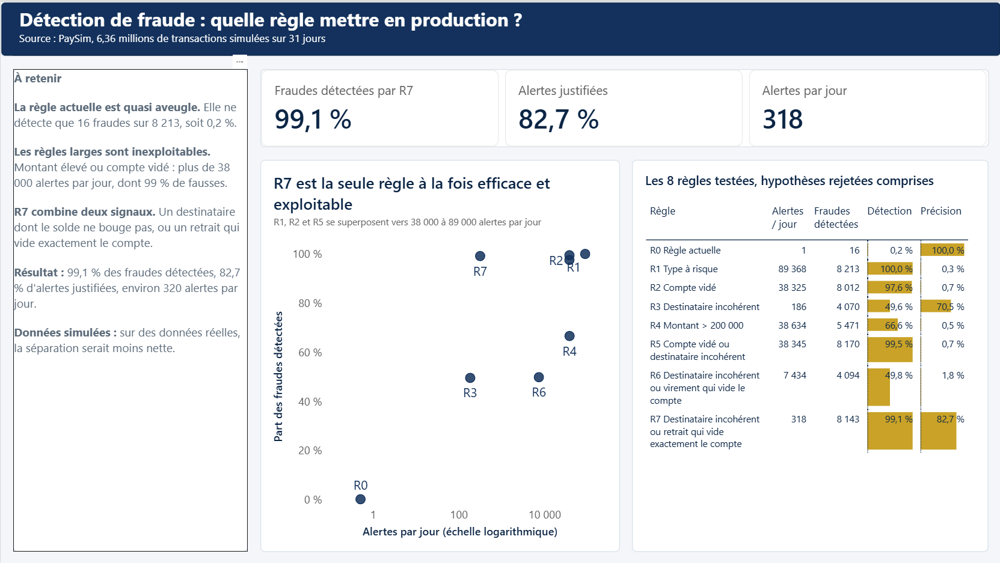
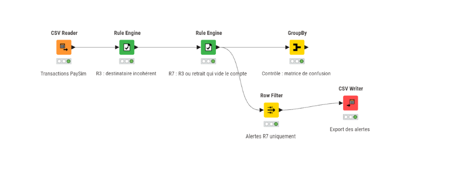
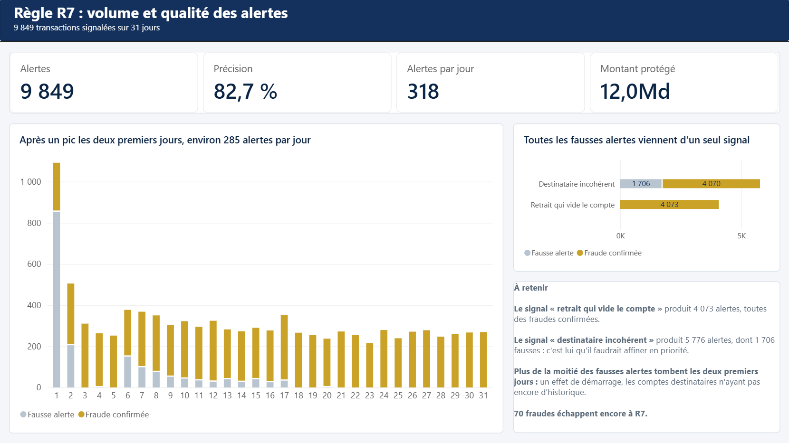

# Détection de fraude bancaire : concevoir une règle de contrôle efficace et exploitable

Comment repérer presque toutes les fraudes sans noyer l'équipe de contrôle sous les alertes ?

## En bref

- Problème : la règle de contrôle actuelle de la banque ne repère que 0,2 % des fraudes (16 sur 8 213).
- Démarche : tester 8 règles sur 6,36 millions de paiements simulés, étudier les fraudes manquées, vérifier le résultat dans un second outil.
- Résultat : la règle retenue repère **99,1 %** des fraudes, avec **83 %** d'alertes justifiées et environ **320 alertes par jour**, un volume qu'une équipe peut traiter.
- Outils : Python, KNIME (outil visuel de traitement de données) et Power BI (tableaux de bord).



## Le résultat en un tableau

| Règle | Alertes par jour | Fraudes détectées | Alertes justifiées |
|---|--:|--:|--:|
| R0 : règle actuelle de la banque | moins de 1 | 0,2 % | 100 % |
| R3 : l'argent arrive sur un compte dont le solde reste à zéro | 186 | 49,6 % | 70,5 % |
| **R7, règle retenue** : R3, ou un retrait qui vide exactement le compte | 318 | 99,1 % | 82,7 % |

Alertes justifiées (ou précision) : la part des alertes qui sont de vraies fraudes.

Pourquoi ne pas tout signaler ? Signaler tous les virements et retraits repère 100 % des fraudes, mais produit environ 89 000 alertes par jour, dont 99,7 % de fausses : aucune équipe ne peut les traiter.

## Compétences mobilisées

- **Concevoir et évaluer des règles de contrôle** : 8 règles comparées sur les mêmes indicateurs.
- **Arbitrer entre détection et volume d'alertes** : écarter des règles qui repèrent plus de 97 % des fraudes mais produisent plus de 38 000 alertes par jour.
- **Analyser les cas non détectés** : les fraudes manquées par R3 ont révélé le signal qui porte la détection à 99,1 %.
- **Mener une recette** (vérifier que deux outils donnent le même résultat) : KNIME et Python comparés transaction par transaction, zéro écart.
- **Restituer à un public non technique** : un tableau de bord Power BI de deux pages.
- **Garder un esprit critique sur les données** : biais de début de période repéré, limites des données simulées signalées.

## Outils

Python (Pandas) · KNIME · Power BI (DAX, Power Query) · Git

---

## Détails techniques

### Données

- Jeu PaySim : transactions de paiement mobile simulées, créé par Edgar Lopez-Rojas.
- Copie utilisée : [Financial Fraud Detection Dataset sur Kaggle](https://www.kaggle.com/datasets/sriharshaeedala/financial-fraud-detection-dataset). Vérifier la licence sur la page Kaggle avant toute réutilisation.
- 6 362 620 transactions sur 743 heures (environ 31 jours), dont 8 213 fraudes : un taux de fraude de 0,129 %.
- La fraude n'existe que dans deux types de transactions : TRANSFER (virement) et CASH_OUT (retrait).
- Les montants sont exprimés dans l'unité monétaire simulée du jeu de données : PaySim ne précise pas de devise.
- Le fichier CSV (environ 470 Mo) n'est pas versionné : voir [data/raw/README.md](data/raw/README.md).

### Indicateurs

- **Taux de détection** (ou rappel) : fraudes détectées / total des fraudes. Mesure ce que la règle attrape.
- **Précision** : fraudes détectées / nombre d'alertes. Mesure la part d'alertes utiles pour l'équipe de contrôle.
- **Alertes par jour** : nombre d'alertes / 31 jours (743 heures). Mesure la charge de travail.

L'exactitude globale (part des transactions bien classées) n'a pas de sens ici : avec 0,129 % de fraude, une règle qui ne signale jamais rien atteint 99,87 % d'exactitude tout en ne détectant aucune fraude.

### Les 8 règles testées

Signaux élémentaires, calculés sur les types à risque (`type` = TRANSFER ou CASH_OUT) :

- **compte vidé** : `oldbalanceOrg > 0`, `newbalanceOrig = 0` et `amount >= oldbalanceOrg`
- **destinataire incohérent** : `oldbalanceDest = 0`, `newbalanceDest = 0` et `amount > 0`
- **vide exactement le compte** : `amount = oldbalanceOrg` et `amount > 0`

| Règle | Définition | Alertes | Par jour | Fraudes détectées | Fausses alertes | Détection | Précision | Décision |
|---|---|--:|--:|--:|--:|--:|--:|---|
| R0 | Règle actuelle (`isFlaggedFraud = 1`) | 16 | 0,5 | 16 | 0 | 0,2 % | 100 % | Point de départ |
| R1 | Tous les TRANSFER et CASH_OUT | 2 770 409 | 89 368 | 8 213 | 2 762 196 | 100 % | 0,3 % | Rejetée : volume |
| R2 | Compte vidé | 1 188 074 | 38 325 | 8 012 | 1 180 062 | 97,6 % | 0,7 % | Rejetée : volume |
| R3 | Destinataire incohérent | 5 776 | 186 | 4 070 | 1 706 | 49,6 % | 70,5 % | Base de R7 |
| R4 | Montant > 200 000 | 1 197 669 | 38 634 | 5 471 | 1 192 198 | 66,6 % | 0,5 % | Rejetée : intuition non confirmée |
| R5 | R2 ou R3 | 1 188 705 | 38 345 | 8 170 | 1 180 535 | 99,5 % | 0,7 % | Rejetée : volume |
| R6 | R3 ou virement (TRANSFER) qui vide le compte | 230 441 | 7 434 | 4 094 | 226 347 | 49,8 % | 1,8 % | Hypothèse rejetée : +24 fraudes seulement |
| R7 | R3 ou retrait (CASH_OUT) qui vide exactement le compte | 9 849 | 318 | 8 143 | 1 706 | 99,1 % | 82,7 % | **Retenue** |

Résultats produits par [python/evaluation_regles.py](python/evaluation_regles.py) et enregistrés dans [outputs/python_evaluation_regles.csv](outputs/python_evaluation_regles.csv).

### Comment R7 a été trouvée

R3 est précise (70,5 %) mais ne repère que la moitié des fraudes. J'ai donc étudié les 4 143 fraudes qu'elle manque : 4 114 sont des retraits (CASH_OUT) et 29 des virements.

En comparant ces fraudes aux retraits honnêtes, un signal ressort : 99,3 % des fraudes manquées vident exactement le compte émetteur (`amount == oldbalanceOrg`), contre 0,0 % des CASH_OUT honnêtes.

Ce détail explique aussi l'échec de R2 : avec `amount >= oldbalanceOrg`, la condition « compte vidé » est remplie par plus d'un million de transactions honnêtes (1 180 062 fausses alertes). L'égalité stricte isole la fraude.

Ajouter ce signal à R3 donne R7 : 4 073 fraudes détectées en plus, sans aucune fausse alerte supplémentaire (1 706 dans les deux cas).

### Recette KNIME contre Python

La règle R7 a été reconstruite dans KNIME, sans code, puis comparée au calcul Python.



Le workflow ([knime/aml_detection.knwf](knime/aml_detection.knwf)) enchaîne : CSV Reader, Rule Engine (R3), Rule Engine (R7), GroupBy (matrice de confusion : alertes croisées avec les fraudes réelles), puis Row Filter et CSV Writer vers [outputs/knime_alertes_R7.csv](outputs/knime_alertes_R7.csv).

Règles saisies dans les nœuds Rule Engine :

```
# R3 -> colonne alerte_R3
$type$ IN ("TRANSFER", "CASH_OUT") AND $oldbalanceDest$ = 0 AND $newbalanceDest$ = 0 AND $amount$ > 0 => 1
TRUE => 0

# R7 -> colonne alerte_R7
$type$ IN ("TRANSFER", "CASH_OUT") AND $oldbalanceDest$ = 0 AND $newbalanceDest$ = 0 AND $amount$ > 0 => 1
$type$ = "CASH_OUT" AND $amount$ = $oldbalanceOrg$ AND $amount$ > 0 => 1
TRUE => 0
```

Méthode de [python/recette_knime.py](python/recette_knime.py) :

1. Recalculer R7 en Python avec exactement les mêmes conditions.
2. Comparer les totaux d'alertes et de fraudes.
3. Vérifier que la clé `step + nameOrig + nameDest + amount` est unique des deux côtés (montant arrondi à 2 décimales).
4. Comparer transaction par transaction avec une jointure externe sur cette clé.

| Contrôle | Python | KNIME |
|---|--:|--:|
| Alertes | 9 849 | 9 849 |
| Fraudes | 8 143 | 8 143 |
| Doublons de clé | 0 | 0 |

| Résultat de la jointure | Transactions |
|---|--:|
| Présentes des deux côtés (`both`) | 9 849 |
| Seulement dans Python (`left_only`) | 0 |
| Seulement dans KNIME (`right_only`) | 0 |

Les deux outils produisent exactement les mêmes alertes.

### Tableau de bord

Le tableau de bord ([powerbi/aml_dashboard.pbix](powerbi/aml_dashboard.pbix), thème [powerbi/theme_banque.json](powerbi/theme_banque.json)) compte deux pages.

- **Page 1, comparaison des règles** (capture en haut de page) : indicateurs clés de R7, nuage de points des 8 règles (part des fraudes détectées selon les alertes par jour, en échelle logarithmique) et tableau complet.
- **Page 2, détail des alertes R7** :



Cette page montre :

- le volume (9 849 alertes, 318 par jour), la précision (82,7 %) et le « montant protégé », c'est-à-dire le montant total des fraudes détectées : environ 12,0 milliards dans l'unité monétaire simulée ;
- les alertes jour par jour, en séparant fausses alertes et fraudes confirmées ;
- l'origine des alertes : toutes les fausses alertes viennent du signal « destinataire incohérent » ; le signal « retrait qui vide exactement le compte » produit 4 073 alertes, toutes des fraudes.

**Effet de démarrage** : 1 059 des 1 706 fausses alertes (62 %) tombent les deux premiers jours de la simulation. Les comptes destinataires n'ont alors pas encore d'historique (solde à 0 avant et après), ce qui déclenche le signal « destinataire incohérent ». En production, une règle fondée sur l'historique des comptes demanderait une période de rodage.

<details>
<summary><strong>Mesures DAX du tableau de bord</strong></summary>

<br>

Huit mesures, sur la table `alertes_R7` (les alertes de la règle R7).

| Mesure | Formule | Valeur |
|---|---|---|
| Alertes | `COUNTROWS ( alertes_R7 )` | 9 849 |
| Fraudes détectées | `SUM ( alertes_R7[isFraud] )` | 8 143 |
| Fausses alertes | `[Alertes] - [Fraudes détectées]` | 1 706 |
| Précision | `DIVIDE ( [Fraudes détectées], [Alertes] )` | 82,7 % |
| Total fraudes | `8213` | 8 213 |
| Taux de détection | `DIVIDE ( [Fraudes détectées], [Total fraudes] )` | 99,1 % |
| Montant protégé | `CALCULATE ( SUM ( alertes_R7[amount] ), alertes_R7[isFraud] = 1 )` | environ 12,0 milliards (unité simulée) |
| Alertes par jour | `DIVIDE ( [Alertes], DISTINCTCOUNT ( alertes_R7[jour] ) )` | 318, sur 31 jours |

`Total fraudes` est une constante : la table ne contient que les alertes de R7, le total des fraudes du jeu complet ne peut pas s'y compter. Si les données changent, elle se met à jour à la main.

</details>

### Enseignements

- Une intuition métier doit être confrontée aux données : l'idée que les gros montants sont suspects (R4) ne tient pas.
- Un taux de détection élevé ne vaut rien sans le volume d'alertes : R2 et R5 détectent plus de 97 % des fraudes mais sont inexploitables.
- Une hypothèse rejetée est un résultat : R6 n'ajoute que 24 fraudes à R3.
- Le signal de R7 a été trouvé en analysant les fraudes manquées par R3.
- Le second signal de R7 ajoute 4 073 fraudes sans aucune fausse alerte supplémentaire.
- Plus de la moitié des fausses alertes tombent les deux premiers jours : un effet de démarrage de la simulation, à anticiper en production par une période de rodage.

### Limites

- **Données simulées** : la séparation de 99,3 % contre 0 % est trop nette pour des données réelles. Elle reflète en partie la façon dont le simulateur génère la fraude.
- **Fraudes restantes** : 70 fraudes ne sont pas détectées par R7.
- **Type de fraude** : PaySim modélise de la fraude par prise de contrôle de comptes, et non du blanchiment au sens strict. Le projet porte donc sur la détection de fraude et la conception de règles de contrôle.
- **Calcul des alertes par jour** : sur 31 jours (743 heures).

### Arborescence du dépôt

```
fraud-bank/
├── README.md
├── requirements.txt
├── .gitignore
├── data/
│   └── raw/
│       ├── README.md                          # où télécharger les données
│       └── Synthetic_Financial_datasets_log.csv   # non versionné
├── python/
│   ├── exploration.py          # exploration du jeu de données
│   ├── evaluation_regles.py    # 8 règles et analyse des fraudes manquées par R3
│   └── recette_knime.py        # recette KNIME contre Python
├── knime/
│   ├── aml_detection.knwf      # workflow exporté, sans données
│   └── workflow_knime.png      # capture du workflow
├── outputs/
│   ├── python_evaluation_regles.csv   # résultats des 8 règles
│   └── knime_alertes_R7.csv           # alertes R7 produites par KNIME
└── powerbi/
    ├── aml_dashboard.pbix
    ├── theme_banque.json
    ├── page1_comparaison_regles.png
    └── page2_detail_alertes.png
```

### Reproduire le projet

1. **Données** : télécharger le jeu PaySim et le placer dans `data/raw/Synthetic_Financial_datasets_log.csv` (voir [data/raw/README.md](data/raw/README.md)).

2. **Dépendances** (testé avec Python 3.14 et pandas 3.0.5) :

   ```
   python -m venv venv
   venv\Scripts\activate          # Windows
   source venv/bin/activate       # macOS, Linux
   pip install -r requirements.txt
   ```

3. **Scripts**, depuis la racine du dépôt :

   ```
   python python/exploration.py
   python python/evaluation_regles.py
   python python/recette_knime.py
   ```

   La recette lit `outputs/knime_alertes_R7.csv`, déjà fourni. Pour le régénérer, exécuter le workflow KNIME.

4. **Workflow KNIME** (créé avec KNIME 5.12) : importer `knime/aml_detection.knwf` dans KNIME (menu d'import ou glisser-déposer dans l'explorateur). Le workflow est fourni sans données. Les nœuds CSV Reader et CSV Writer utilisent des chemins absolus : les remplacer par l'emplacement de `data/raw/Synthetic_Financial_datasets_log.csv` et de `outputs/knime_alertes_R7.csv` sur votre poste, puis exécuter le workflow.

5. **Tableau de bord** : ouvrir `powerbi/aml_dashboard.pbix` avec Power BI Desktop. Si les sources de données ne sont pas trouvées, mettre à jour leur chemin (Transformer les données, puis Paramètres de la source de données).

---

## Contact

<div align="center">

### Alexis Claudeon
**Data Analyst | Analytics Engineer junior**

[](https://github.com/Alexis45140)
[](https://www.linkedin.com/in/alexis-claudeon)
[](mailto:alexis.claudeon@outlook.fr)

</div>
